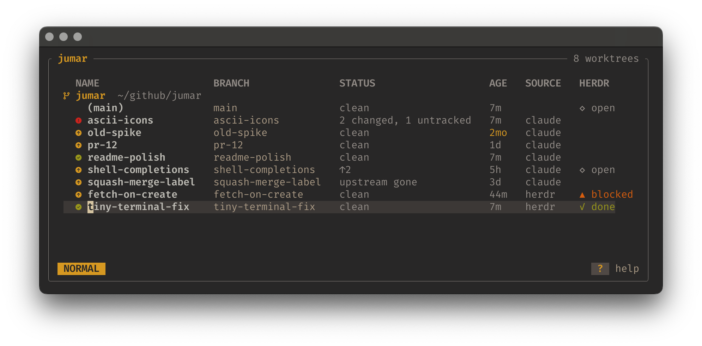

# jumar

jumar shows your git worktrees as a text buffer that you edit like a file, in the style of
[oil.nvim](https://github.com/stevearc/oil.nvim). Delete a line to remove a worktree. Edit a
directory or a branch to rename it. Add a line to create one. Then type `:w` to review the
changes and apply them.

<p align="center">
  
</p>

- It finds Claude Code and herdr worktrees, and every other worktree of the same repos.
- Before it removes a worktree, it shows what the remove loses.
- It runs in a terminal, as a [herdr](https://herdr.dev) plugin, or as a picker for coding
  agents.

## Install

```sh
brew install joshbarrington/tap/jumar
# or
curl -LsSf https://github.com/joshbarrington/jumar/releases/latest/download/jumar-installer.sh | sh
# or, from source
cargo install --locked --git https://github.com/joshbarrington/jumar jumar
```

You need:

- macOS or Linux, and git 2.17 or later.
- A [Nerd Font](https://www.nerdfonts.com) in your terminal, for the icons.
- Optional: [herdr](https://herdr.dev), [revdiff](https://github.com/umputun/revdiff) and
  the reviewr herdr plugin, for the HERDR column and the tool presets.

### Shell integration

Add the shell function, so that Enter moves your shell into the worktree:

```sh
eval "$(jumar init zsh)"   # in ~/.zshrc, or bash in ~/.bashrc
jumar init fish | source   # in ~/.config/fish/config.fish
```

Without the function, Enter prints the path.

### herdr

```sh
herdr plugin install joshbarrington/jumar
```

In herdr, jumar opens in a floating pane, and Enter goes to the herdr workspace of the
worktree. The HERDR column shows the agent in each workspace: working, blocked, done or idle.

### Claude Code and other agents

```sh
/plugin install jumar --marketplace joshbarrington/jumar
```

Ask Claude to "pick a worktree", and jumar opens over the session in herdr, tmux or WezTerm.

| Key | Claude |
|---|---|
| `Enter` | works in the worktree |
| `Tab` | gets the worktree as context (`V` then `Tab` for several) |

The skill in `skills/jumar` is plain instructions and a launcher script for
`jumar pick --output <file>`. Other agents that read skills can use it too.

## Use

Run `jumar` to open the buffer. Nothing changes until you type `:w`.

| Keys | Action |
|---|---|
| `j` `k` `gg` `G` `h` `l` `w` `b` `0` `$` | move (counts work: `3j`, `5G`) |
| `/` | filter by name, repo, source or branch |
| `dd` | remove the worktree |
| `v` `V`, then `d` | remove the selected worktrees (`o` jumps to the other end) |
| `:clean` | remove every safe (green) worktree that the filter shows |
| `cw` `ciw` `x` `i` `a` `A` `I` | edit the directory or branch |
| `o` `O` | create a worktree (see [Create](#create)) |
| `u` `Ctrl-r` | undo, redo |
| `:w` `:wq` `:q` `:q!` | apply, apply and quit, quit, quit without saving |
| `Enter` | go to the worktree |
| `yp` | copy the path of the worktree |
| `R` `:e` | reload all statuses (`:e!` also drops your edits) |
| `<Space>d` | open revdiff on the changes of the worktree |
| `<Space>r` | open reviewr in the herdr workspace of the worktree |
| `?` | show the keys |

Each repo starts with its own checkout, shown as `(main)`. You can go to it, but you cannot
remove or rename it. jumar also lists the repo that you run it from, and each `[[repo]]` in
the configuration. This lets you create the first worktree from the `(main)` line.

### Remove

The mark at the start of each line shows what a remove loses:

| Mark | Worktree | On remove |
|---|---|---|
| green | clean, and merged or fully pushed | deletes the checkout and the branch |
| yellow | clean, with commits that exist nowhere else | deletes the checkout, keeps the branch |
| red | uncommitted or untracked changes | needs force, and lists what you would lose |

- "upstream gone" means that the remote branch was deleted. The PR was probably merged, but
  jumar cannot be sure, so the line stays yellow.
- AGE is the time since the last commit. It turns yellow after 30 days.
- To clean one repo, filter to it with `/`, then type `:clean`. Type `u` to bring the lines
  back.

After `:w`, a review screen lists each change:

| Keys | Action |
|---|---|
| `j` `k` | move between changes |
| `D` | also delete the branch, or keep it |
| `f` | force: for changes, a lock, or a running herdr agent |
| `y` | apply |
| `q` `Esc` | go back to the buffer |

Just before jumar deletes a branch, it grades the branch again. If the branch is no longer
green, jumar keeps it and tells you.

### Rename

Each line is the worktree's directory, then its branch: `tui  feat/tui-improvements`. Edit
either word:

- Edit the directory to move the worktree. Its branch stays as it is.
- Edit the branch to rename the branch. The directory stays, and this works on a locked
  worktree too.
- Edit both to do both.

The branch is the last word, so a directory name can contain spaces. A checkout without a
branch, such as a detached one, has only its directory to edit.

Before it moves anything, jumar blocks a new branch name that git does not allow, that already
exists, or that clashes with a branch it would nest under or over: `jb/fix` cannot exist next
to `jb`. You cannot rename a worktree or its branch while a herdr agent runs in it.

### Create

Press `o` or `O` on a worktree, then type a branch, or a directory and then a branch. The new
worktree goes in the same repo and source as the line you pressed it on, unless the line names
a repo with `repo:`. The new line shows under the repo it goes in, and a hint under it shows
what it will create, or why it can't:

| Line | Creates |
|---|---|
| `fix` | branch `fix` from the default branch of the repo, in the directory `fix` |
| `feat/tui` | branch `feat/tui`, in the directory `feat-tui` |
| `tui feat/tui` | branch `feat/tui`, in the directory `tui` |
| `app:fix` | branch `fix`, in the repo `app` |
| `~/code/app:fix` | branch `fix`, in the repo at `~/code/app`, even if jumar doesn't list it |
| `fix@v2` | branch `fix` from `v2` |
| `fix`, when branch `fix` exists | a worktree for the existing branch |
| `fix`, when only `origin/fix` exists | branch `fix` that tracks `origin/fix` |
| `#123` | pull request 123, as branch `pr-123` |
| `review@#123` | pull request 123, as branch `review` |

- `app/fix` is always the branch `app/fix`, even if you have a repo named `app`.
- Before `:`, text with a `/` or a leading `~`, or `.` alone, is a path to a repo; anything
  else, like `.dotfiles`, is the name of a listed repo. If jumar lists no repos, press `o`
  and give a path.
- A new line that checks out an existing branch is blocked if another worktree already has
  that branch checked out.
- jumar blocks a start that is not a branch, tag or commit before it changes anything. A
  remote branch that is not fetched yet, such as `origin/new`, is allowed when
  `fetch_on_create` is on. If its fetch fails, nothing is created.
- Two lines cannot use the same directory or the same branch, or branches that nest, such as
  `jb` and `jb/a`. A new line also cannot use a branch that the same save removes or renames;
  apply that first.
- If the start is a remote branch, such as `origin/main`, jumar fetches it first. If the fetch
  fails, the worktree starts from the last fetched commit, and the report tells you.
- A pull request comes from the `upstream` remote if it exists, else from `origin`. jumar
  reads it with git, so it does not need `gh`. GitLab works if the remote URL contains
  "gitlab".
- The branch of a pull request has no upstream. To push your changes, push to a new branch.

## What jumar finds

| Source | Finds | Creates in |
|---|---|---|
| `claude` | `~/*/.claude/worktrees/*` and `~/github/*/.claude/worktrees/*` | `{repo}/.claude/worktrees/{name}` |
| `herdr` | `~/.herdr/worktrees/*/*` | `~/.herdr/worktrees/{repo_name}/{name}` |
| other | the other worktrees of each repo above, of the current repo, and of each `[[repo]]` | |

New worktrees go to `herdr` inside herdr, and to `claude` outside it. To change this, set
`default_create_source`. If your repos are in a different place, add a source.

## Configuration

The configuration file is `~/.config/jumar/config.toml`. Every setting is optional.

```toml
default_create_source = "work"
fetch_on_create = true   # fetch a remote start, such as origin/main, before a create
refresh_seconds = 5      # how often statuses refresh; 0 turns refresh off

[[repo]]
path = "~/work/app"
default_branch = "develop"              # else origin/HEAD, main or master
copy = [".env", "config/*.local.toml"]  # files to copy into each new worktree
on_create = ["npm install"]             # commands to run in each new worktree

[[source]]
name = "work"
globs = ["~/work/*/.worktrees/*"]
create_path = "{repo}/.worktrees/{name}"

[[source]]
name = "claude"   # the name of a preset: replaces its globs
globs = ["~/code/*/.claude/worktrees/*"]

[[tool]]
name = "lazygit"
key = "g"           # run with <Space>g
command = ["lazygit"]
mode = "suspend"    # suspend | herdr-workspace | detach
```

### Repos

- `default_branch` sets what counts as merged. New worktrees and `{base}` start from it.
- `copy` takes globs relative to the main checkout. jumar copies a file only if it exists, and
  never replaces a file that git checked out.
- Each `on_create` command runs with `sh -c` in the new worktree. `JUMAR_REPO` holds the path
  of the main checkout, and `JUMAR_WORKTREE` holds the path of the new worktree.
- If a command fails, jumar keeps the worktree and shows the end of the command output.

### Sources

- A source with the name `claude` or `herdr` changes that preset. Its globs replace the preset
  globs, and empty globs turn the preset off.
- `create_path` can use `{repo}` (the path of the main checkout), `{repo_name}` and `{name}`.
  `{name}` is the branch name with each `/` changed to `-`.

### Tools

- A tool command can use `{path}`, `{repo}`, `{branch}`, `{default_branch}` and `{base}`.
  `{base}` is the commit where the branch left the default branch.
- `revdiff` and `reviewr` are presets. A tool with the same name changes only the fields that
  it sets, and `command = []` removes the preset.
- If a tool is not valid, jumar does not start, and the error names the tool.

```toml
[[tool]]
name = "difftastic"
key = "t"
command = ["git", "-c", "diff.external=difft", "diff", "{base}"]
```

## Scripting

`jumar list` prints a table of the worktrees, and `jumar list --json` prints JSON. The list
leaves out the main checkout of each repo. Each JSON entry has these fields:

- `path`, `repo`, `source`, `head` and `health`.
- `tier`: `safe`, `unmerged` or `dirty`.
- `last_commit`: the time of the last commit, in Unix seconds.
- `status`: `branch`, `upstream`, `upstream_gone`, `ahead`, `behind`, `changed`, `untracked`
  and `conflicted`.

## Contributing

Read [CONTRIBUTING.md](CONTRIBUTING.md) to set up and run the checks.
[CHANGELOG.md](CHANGELOG.md) lists the changes in each release. jumar uses the
[MIT](LICENSE) license.
